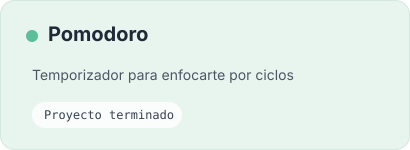
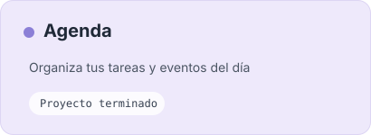

  

  &nbsp;
  &nbsp;
  

## Sobre mí

Ingeniera en Sistemas Computacionales, desarrolladora web y diseñadora UI/UX, especialista en e-commerce. Creo tiendas y sitios en **Shopify, WordPress y Tiendanube** y apps móviles.

## Stack

  
  
  
  
  
  
  

## Proyectos

<table>
  <tr>
    <td width="50%"></td>
    <td width="50%"></td>
  </tr>
</table>

## Tipo de codificación

  

